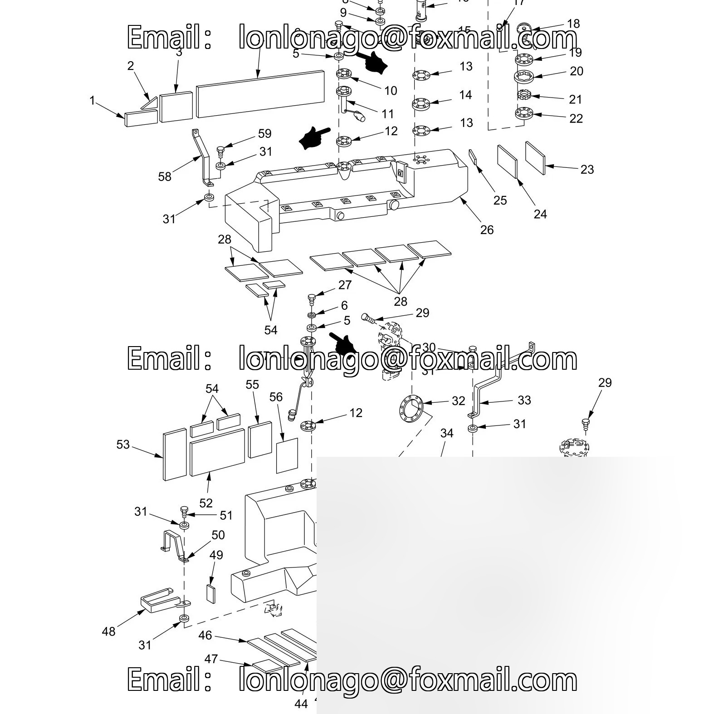
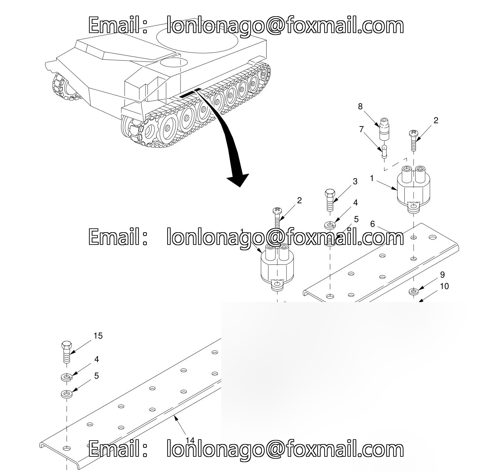

# 155mm M109A6 medium self-propelled gun howitzer carriage (chassis) related components

## Body

155 Millimeter M109A6 Medium Self-Propelled Artillery Tractor Body (Chassis) Related Components
Parts catalog PDF , 695 pages
M109A6 is the first digital artillery system capable of independent self-guided shooting by the US military, equipped with advanced fire control computers, inertial navigation, and automatic positioning systems, completing artillerist operations and combat within 60 seconds, achieving efficient "hit and move" tactics.
complete content, directly send the cloud drive link.

The components related to the 155mm M109A6 medium self-propelled grenade launcher chassis include a Parts Catalog PDF with 695 pages.

<!-- AI_ENRICHED -->

## Images

## Payment

Here is a pay link on Stripe ( https://buy.stripe.com/3cs8yP7sY87d0vu9AB ). Please contact me lonlonago@foxmail.com after funding $89, and I will send you a complete data files , thank you!

